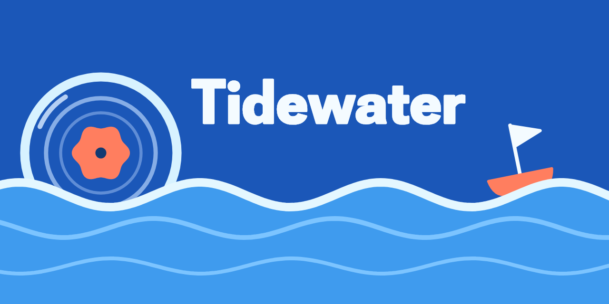

<p align="center">
  
</p>


## About

Heya! made this as a way to practice using AI to write code, and because I couldn't find a music player for windows that I liked. Claude helped with most of the code for this, and I will admit, as a computer science student, it feels a little weird. After this project is done, I plan to mostly only use AI to assist in development of applications and programs, with mostly human written code. As for this repo, itll be maintainted with security fixes, occasional new features, and eventual addition of a proper website and cross platform support. Anyway, enough of me yapping. Enjoy Tidewater! Its the music client I always wanted. 

-J


## What it is

Tidewater is a desktop music client for [Navidrome](https://www.navidrome.org) (and other OpenSubsonic servers),
built with Flutter for Windows in the Material 3 Expressive style: springy motion, shapes that morph, a wavy
progress bar, and colors that follow the album you're playing.

- Browse your library by albums, songs, artists, playlists and liked songs
- Gapless playback with media keys and the Windows media overlay, plus scrobbling to your server
- Synced lyrics (from your server, or from [LRCLIB](https://lrclib.net) if you allow it)
- A fullscreen Now Playing with visualizer styles, a docked or popup queue, and an idle mode
- The whole app recolors from the cover art of what's playing

## Platforms

| Platform | Status |
|---|---|
| Windows | In development (this is what exists today) |
| Linux | Planned, after the Windows app is complete |
| Android | Planned (phone layouts in portrait and landscape), if good audio quality is feasible: equalizer, exclusive USB audio, bit-perfect output for players like HiBY |

The order and details are in [docs/milestones.md](docs/milestones.md) (M10 to M13).

## Get started

You need Flutter (stable), Visual Studio 2022 with the "Desktop development with C++" workload, and Rust
(`rustup`, needed by `smtc_windows` for media keys and the Windows media overlay).

```bash
flutter pub get
flutter run -d windows
```

Sign in with your server address and a username and password (or an API key).

```bash
flutter analyze
flutter test
flutter build windows --release
```

## Project notes

| File | What's in it |
|---|---|
| [CLAUDE.md](CLAUDE.md) | The design and behavior guide the app is built from |
| [docs/milestones.md](docs/milestones.md) | What is done, what is simulated, what each milestone covers |
| [docs/dev-notes.md](docs/dev-notes.md) | How to verify changes and lessons learned (animation rules, things not to redo) |
| [docs/tidewater-m3e-demo.html](docs/tidewater-m3e-demo.html) | Interactive reference for the design |
| [docs/mockups/](docs/mockups) | Static layouts, plus rough mobile mockups and a prototype |
| [docs/archive/](docs/archive) | Old WinUI mockups and notes from an idea that was dropped |

## Credits

Icon artwork and fonts come from other people's work; see the Credits card in the app's Settings and the
licenses in [third-party-licenses/](third-party-licenses):

- UseAnimations (MIT): Library, Cast, Artists, Lists, Radio, Settings and Volume icons
- Lucide and Lucide Animated (ISC and MIT): the Home icon
- Google Sans Flex (SIL Open Font License): the name on the banner (the font file is kept in `tool/branding/fonts` to regenerate it)

## License

Tidewater is released under the [MIT License](LICENSE). The icon artwork and fonts it uses carry their own
licenses, listed under Credits above.
